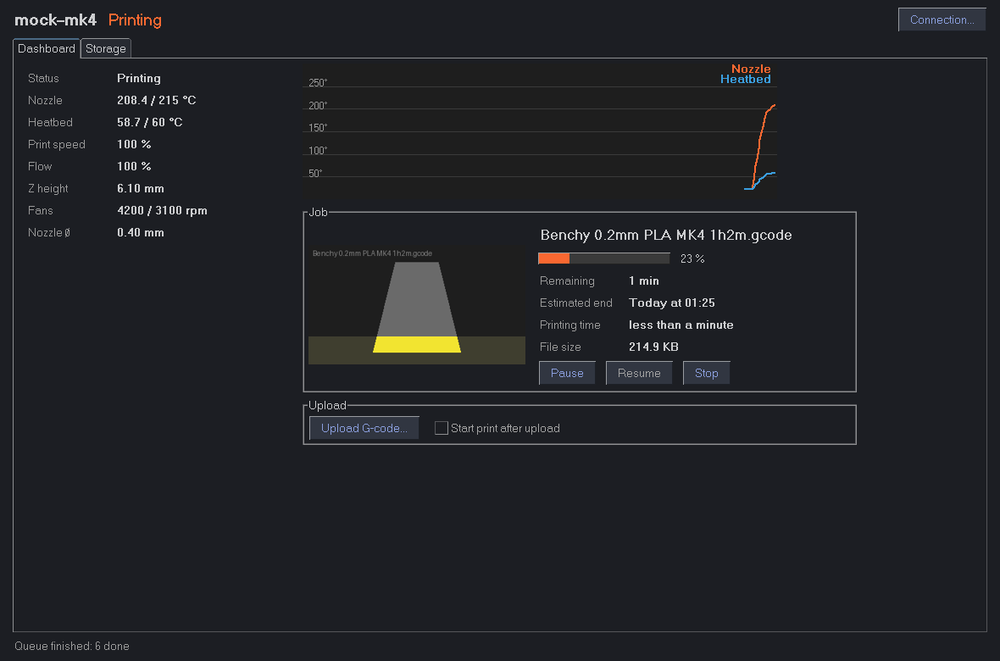
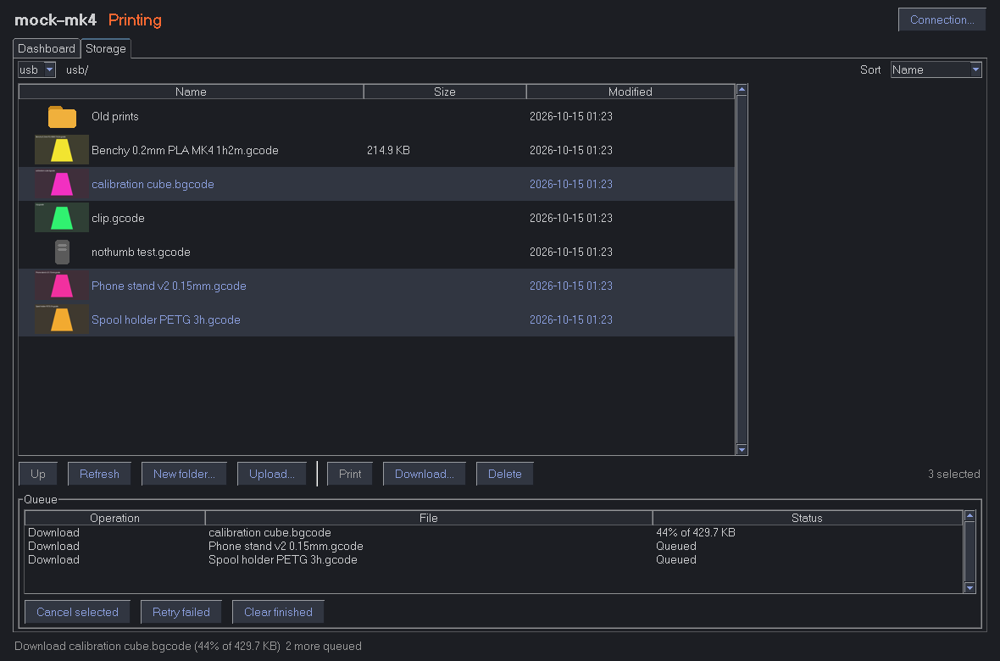

# PrusaLink Desktop

A desktop client for [PrusaLink](https://github.com/prusa3d/Prusa-Link), the local web API on Prusa
printers (built into the firmware of the MK4/MK3.9/MINI/XL/Core One, or running on a Raspberry Pi
for the MK3). It covers the dashboard of the [built-in web app](https://github.com/prusa3d/Prusa-Link-Web)
and adds what that app is missing for managing lots of files: thumbnails cached on disk, and bulk
download, delete and upload through a queue that runs one transfer at a time.




## Features

- **Dashboard**: printer state, nozzle/bed temperatures with a graph, speed, flow, Z height, fans,
  nozzle diameter; the current job with its thumbnail (greyed out above the printed height), progress,
  remaining time, estimated end and print time; pause, resume and stop; upload a G-code, optionally
  starting the print right away.
- **Storage**: browse storages and folders, sort by clicking a column header, see a preview and the
  details of the selected file, start a print, create folders. Select several files (Ctrl/Shift-click)
  to **download**, **delete** or **upload** them in bulk.
- **Queue**: every download, delete and upload goes into a queue that the app works through one
  file at a time, with progress, cancellation and retrying of failed items.
- **Thumbnail and size cache**: thumbnails and file sizes are stored on disk, keyed by printer, file
  and modification time, so each is fetched once per file. Files without a preview are remembered too.

## Install and run

Needs Python 3.8+ with Tk (included with the python.org installers; on Debian/Ubuntu,
`sudo apt install python3-tk`).

```sh
pip install -r requirements.txt
python prusalink_desktop.py
```

On first start, enter the printer's address (IP address or hostname) and its PrusaLink credentials.
On firmware-based printers the username is `maker`, and the password is shown on the printer under
*Settings > Network > PrusaLink*. These printers also accept the password as an API key: leave the
username empty to send it as an `X-Api-Key` header, which avoids the Digest login round trips.

## Going easy on the printer

The HTTP server on the printer runs on a microcontroller with three connection slots, so the app
is careful with it:

- It never has more than two requests in flight: one connection polls status (every 2 seconds) and
  runs quick requests, the other works through the queue and the thumbnails. Both use keep-alive.
- Queued operations run strictly one after another. Thumbnail fetches are interleaved with them,
  one at a time, so neither a bulk download nor a folder full of new thumbnails holds up the other.
- Firmware-based printers leave file sizes out of folder listings, so the app asks for each missing
  size, one at a time. These requests are quick and go over the status connection, so the sizes
  fill in well before the (slow) thumbnails.
- The open folder is re-checked every 10 seconds while the Storage tab is visible, using the
  firmware's ETags, so an unchanged folder costs a `304 Not Modified`.
- After a transfer is cancelled, the app waits a second before starting the next one.

## Where things are stored

- Settings, including the password **in plain text**, are in `PrusaLink-Desktop.json` in
  PySimpleGUI's settings folder: `~/.config/PySimpleGUI/settings` on Linux,
  `~/Library/Application Support/PySimpleGUI/settings` on macOS,
  `%LOCALAPPDATA%\PySimpleGUI\settings` on Windows. Add `"poll_interval": 5` there to poll less often.
- Thumbnails and sizes are in `PrusaLink-Desktop/thumbnails` and `PrusaLink-Desktop/sizes` in the user
  cache folder (`~/.cache`, `~/Library/Caches` or `%LOCALAPPDATA%`). Delete them to clear the cache.

## Limitations

- Downloads skip folders (deleting a folder deletes its contents).
- Cameras, printer settings and the Raspberry Pi version's printer controls are not included.

## Development

`prusalink.py` holds the API client, the worker "lanes" and the thumbnail cache, with no GUI code.
`prusalink_desktop.py` is the PySimpleGUI app.

`tools/mock_printer.py` is a fake printer modelled on the firmware: Digest and API-key auth,
8.3 short file names, ETags, generated thumbnails, a simulated print, throttled transfers, and a
log of how many requests were in flight at once. Use it to try changes without a real printer:

```sh
python tools/mock_printer.py            # serves sample files on port 8080, password "secret"
python tools/mock_printer.py --dir ~/gcodes --rate 200000 --latency 0.2
```

The tests run the client against the mock:

```sh
pip install pytest
pytest
```
